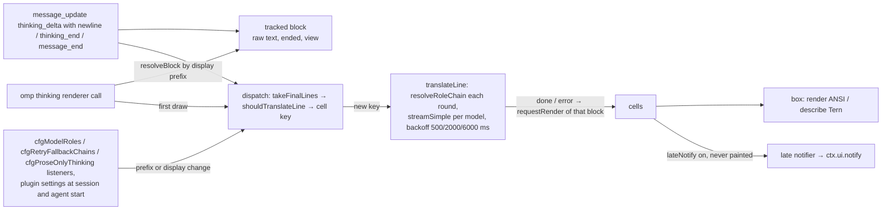

# Repository Guidelines

## Project Overview

`omp-thinking-translator` is an [Oh My Pi](https://github.com/oh-my-pi) (omp) plugin that draws a translated copy of each visible assistant thinking line under its thinking block. Translation is display-only and memory-only: nothing is written to the session file, model requests or compaction input, and the plugin writes no files. It is omp-only and depends on omp's package exports directly.

- **Settings** are omp plugin settings declared in `package.json` `omp.settings` (`enabled`, `targetLanguage`, `lateNotify`), read with `getPluginSettings`.
- **Translator models** are omp's model role `@omp-thinking-translator`, with ordered fallbacks in `retry.fallbackChains["omp-thinking-translator"]` and per-entry reasoning levels as `:level` selector suffixes. An unbound role means no translation.
- **Diagnostics** go to `pi.logger` at debug level as `thinking-translator: <event>` records in `~/.omp/logs/omp.<date>.<pid>.log`.

The package is `private` and installed from git (`#release`). `CLAUDE.md` holds the dependency and release policy; read it before touching dependencies, `version` or `CHANGELOG.md`.

## Architecture & Data Flow

One translator session exists per main interactive omp session (`ctx.mode === "tui"`, `ctx.agent.kind === "main"`); subagents, print and RPC modes get none. All state belongs to that session object, nothing lives in module scope.



Dispatch is driven by omp events and by a block's first draw, never by rendering; the box only reads cells. The design invariants live as module header comments next to the code that enforces them; read the header of a module before changing it.

## Key Directories

| Path | Purpose |
| --- | --- |
| `index.ts` | Entry: session lifecycle (`session_start`/`session_switch`/`session_shutdown`), renderer and `/thinking-translator` registration, message event wiring |
| `src/session.ts` | Per-session state, event-driven dispatch, settings listeners, one-shot notices, `cellKeyPrefix` |
| `src/settings.ts` | Plugin settings schema from `package.json`, parsing with per-key defaults |
| `src/role.ts` | Role binding, chain resolution with one discovery retry, thinking level → `streamSimple` reasoning options |
| `src/translate.ts` | Per-line request loop over the chain, prompt, `SOURCE_TEXT_BEGIN` guard, output cleanup |
| `src/lines.ts` | Latin gate, line key normalization, line bound helpers |
| `src/blocks.ts` | Tracked blocks, display text via omp's `formatThinkingForDisplay`, incremental final lines, block resolution |
| `src/renderer.ts` | One box component per block: ANSI `render`, Tern `describe` |
| `src/late-notify.ts` | Late-notification queue and payload building (`lateNotify`) |
| `src/status.ts` | `/thinking-translator` status report |
| `tests/thinking-translator.test.ts` | Unit tests and host contract tests |
| `omomp-shared/` | Byte-identical copies of `oh-my-omp/shared` files declared in `omomp-shared.json` (`i18n.ts`, `biome.base.json`); never edit them |
| `README.md`, `README.zh-CN.md` | User docs in English and Simplified Chinese, kept in step |
| `TODO.md` | Open work |

## Development Commands

```bash
bun install                 # bun is the package manager; bun.lock is the only lockfile
bun run format              # Biome formatting and safe fixes
bun run check               # biome check . && tsc --noEmit — required before every commit
bun test                    # tests/**/*.test.ts
bun test -t "cell key"      # one test by name substring

# Live omp without installing; --no-extensions keeps an installed copy of this plugin out
omp --no-extensions -e /absolute/path/to/omp-thinking-translator/index.ts
omp plugin install https://github.com/oh-my-omp/omp-thinking-translator#release
```

## Code Conventions & Common Patterns

- TypeScript ESM formatted by Biome (`biome.json` extends `omomp-shared/biome.base.json`: tabs, width 140, double quotes).
- Host capabilities come from omp's own exports: settings handles from `@oh-my-pi/pi-coding-agent/session/settings` and `config/model-settings`, `resolveRoleChain`/`roleCandidatePool`, `getPluginSettings`, `formatThinkingForDisplay`, thinking-level helpers from `@oh-my-pi/pi-tui/thinking`. A new host subpath must be confirmed to load in a real omp process, since the omp binary maps only exported paths.
- Host settings are read through `pi.pi.settings` (the host instance) on every use, never copied.
- Timers go through `ctx.setTimeout`/`ctx.clearTimer`; one `AbortController` per session cancels every request on dispose.
- Parse at the boundary: plugin settings arrive as `unknown` values and become `TranslatorSettings`; `TranslationProgress` is a discriminated union handled with exhaustive `switch`.
- Expected failures become state plus a one-shot `ctx.ui.notify`; nothing throws into the host.
- User-facing text goes through `tr()` from `omomp-shared/i18n.ts`; the translator prompt is not localized.

## Testing & QA

- Bun runs `node:test`/`node:assert/strict` tests: flat tests, inline literals, no mocks.
- Covered: settings parsing, reasoning options, discovery providers, cell key prefix, the Latin gate, line keys, incremental final lines, block resolution, output cleanup, the split-marker guard, late-row payloads. Two contract tests run omp's own code: final lines taken while a block streams must equal the finished block's display lines under `formatThinkingForDisplay`, and every reveal frame `buildDisplayMessage` produces must resolve to its block.
- Not covered by unit tests: the session's event wiring, live model calls, discovery, ANSI scrollback and Tern surfaces. Verify those in a real omp PTY session with `--no-extensions -e index.ts` and a `--config` overlay binding the role: send an English prompt with a visible multi-line thinking block, watch the box title reach `done/total`, and read the session's records in `~/.omp/logs/omp.<date>.<pid>.log` (`activate → dispatch → request → done → painted`, `modelFailed` before a fallback). Check the unbound role (one notice, no `request` records) and `enabled: false` (a project `.omp/plugin-overrides.json`) the same way.
- The Tern surface: `tern serve --control <socket>` runs a headless Tern that `tern ctl --control <socket> --file <scenario>` drives (`run`, `type`, `key`, `click`, `plugins expect`, `shot`). Start omp in it with `PI_TUI_TSP_RECORD=<file>` and read the recorded ops of the box's ids; check a folded finished box (`expandThinkingBlocks: false`) still shows its title, and that a later turn leaves earlier boxes intact.
- A failing contract test after a dependency bump means omp changed its thinking display; adapt the plugin, never pin the dependency back.

## Releases

`.github/workflows/omomp-check.yml` runs the shared omomp check (install, `bun run check`, `bun run test`, shared-copy comparison) on every push to `main` and every PR.

A commit writes its user-visible entries under `## [Unreleased]` in `CHANGELOG.md` and changes no version: after `git add`, run `uvx --from lgit-cli lgit`. The daily release run (`.github/workflows/omomp-release.yml`, 02:00 GMT+9) publishes that section; see `CLAUDE.md`.
